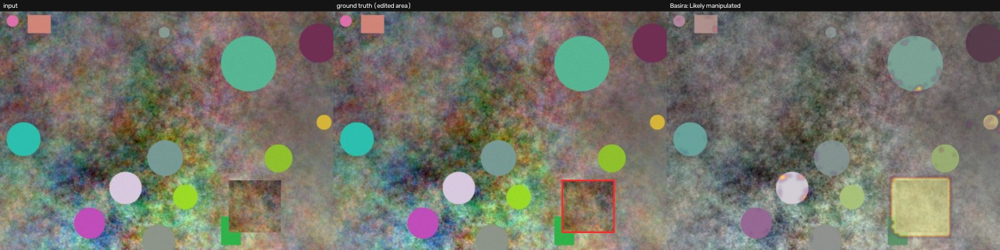

<div dir="rtl">

# بصيرة · Basira

**تحليل جنائي رقمي قابل للتفسير للصور والصوت والفيديو المعدَّلة أو المولَّدة بالذكاء الاصطناعي.**
تُظهر الأداة *أين* عُدِّل الملف و*لماذا* تظن ذلك، وتقول بوضوح متى لا تستطيع الحكم.

[English](README.md) · [كيف يعمل كل كاشف](docs/METHODS.md)



## ما هي

حزمة بايثون واحدة فيها ثلاثة محركات وتقرير موحَّد:

| المحرك | ماذا يكشف | كيف يحدد المكان |
|---|---|---|
| **الصور** | التركيب (splicing)، النسخ واللصق داخل الصورة، الترميم الناعم (generative fill)، بيانات المولِّدات، وسوم C2PA و IPTC، الصورة المصغَّرة القديمة في EXIF، بصمة المولِّدات في الملفات غير المضغوطة | خريطة حرارية ومربعات |
| **الصوت** | القطع في التسجيلات التي فيها طنين كهرباء (قفزة الطور ENF)، المقاطع المُدرجة من غرفة أخرى (تغيّر ضجيج الخلفية في الوقفات)، الصمت الرقمي المُدرج، نقرات القطع، مؤشرات تحويل النص إلى كلام | مقاطع زمنية |
| **الفيديو** | حذف إطارات داخل لقطة متصلة، إعادة عرض لقطات سابقة، تجميد الإطارات، قوائم التحرير، وسوم المولِّدات، مع تحليل المسار الصوتي كاملاً. تغيّر المصدر وآثار الترميز السابق تُعرض للعلم فقط | مقاطع زمنية |

ما يميزها:

- **أدلة لا رقم سحري.** كل كاشف طريقة معالجة إشارة موثَّقة تعرض قياسها الخام وعتبتها وجملة بلغة واضحة وخريطة أو مقطعاً زمنياً.
- **معايرة على الهدوء.** درجة الكاشف تساوي 0.5 عند عتبة قراره بالضبط، والعتبات مضبوطة على توزيعات مقاسة لملفات سليمة.
- **لا تقول "أصلي" أبداً.** أفضل نتيجة ممكنة هي "لم تُوجد آثار مهمة"، لأن إعادة الضغط وتغيير الحجم والتعديل المتقن تمحو الآثار.
- **بلا تنزيل نماذج ولا شبكة ولا GPU.** الملفات لا تغادر جهازك.

## التثبيت والاستخدام

```bash
pip install git+https://github.com/OWNER/basira.git
```

```bash
basira scan photo.jpg --lang ar             # ملخص في الطرفية + تقرير HTML بالعربية
basira scan evidence/ -r --report-dir reports/ --csv summary.csv
basira scan evidence/ -r --jobs 4 --timeout 300    # فحص متوازٍ بحد زمني لكل ملف
basira scan evidence/ -r --jsonl > results.jsonl
basira serve                                # واجهة محلية بالسحب والإفلات (عربي / إنجليزي)
basira doctor                               # فحص ffmpeg والمكتبات
```

التقرير ملف واحد مستقل بالعربية أو الإنجليزية، بلا أي طلب خارجي: الحكم مع ما يعنيه وما لا يعنيه، وخريطة المكان بطبقات لكل كاشف ومقارنة قبل/بعد، ومحور زمني واحد للصوت والفيديو. التفاصيل في [docs/USAGE.md](docs/USAGE.md) و[SECURITY.md](SECURITY.md).

```python
import basira
r = basira.analyze("photo.jpg")
r.verdict, r.scores, r.fused_heatmap, r.fused_segments
```

## نتائج مقاسة

كل رقم هنا يُنتجه سكربت في هذا المستودع ويمكنك إعادة تشغيله. لا انتقاء: أول تشغيل على البيانات العامة كان سيئاً، وما أُصلح بسببه مذكور تحته.

### مجموعات بيانات عامة

`benchmarks/public_datasets.py` بالعتبات الافتراضية.

| المجموعة | أصلية أُنذر عليها | مزوّرة أُنذر عليها | دقة تحديد المكان (F1) حين تُكشف |
|---|---|---|---|
| **Columbia** (183 صورة كاميرا أصلية، 180 مركّبة، غير مضغوطة) | **0 / 183** | 55 / 180 (31%) | 0.72 |
| **CoMoFoD** (200 أصلية، 200 بالنسخ واللصق) | **0 / 200** | 159 / 200 (80%) | 0.83 |

CoMoFoD بعد إعادة ضغط الصورة كلها بـ JPEG:

| الجودة | Q100 | Q90 | Q80 | Q70 | Q60 | Q50 | Q40 | Q30 | Q20 |
|---|---|---|---|---|---|---|---|---|---|
| مزوّرة أُنذر عليها (من 200) | 78 | 129 | 91 | 69 | 58 | 51 | 37 | 22 | 6 |
| أصلية أُنذر عليها (من 200) | 0 | 5 | 3 | 3 | 0 | 3 | 0 | 0 | 0 |

أعداد الكشف مطابقة لخط الأساس السابق. تصحيح مقام F1 عند الكشف يغيّر JC6 من
0.715 إلى 0.704، لأن التزوير المكتشف ذا التداخل الصفري يبقى الآن في المتوسط.
لم يتغير F1/IoU لجميع الصور المزوّرة ولا ROC-AUC بالدقة المطبوعة.

- **الإخفاق في الكشف شائع، والإنذار الكاذب نادر إلا على الأشياء المصنّعة المتكررة** (12 من 100 من أصول COVERAGE، انظر جدول خارج العينة). هذا مقصود في أداة قد تُستخدم نتيجتها ضد شخص، لكنه يعني أن النتيجة النظيفة لا تثبت شيئاً.
- **CoMoFoD:** النسخة السابقة أنذرت على 12 صورة أصلية فيها أشياء **مطبوعة** متطابقة (قواعد أكواب، ملصقات مجلدات). كاشف النسخ واللصق الجديد يشترط أن يجتاز كل استنساخ مرشَّح عدة اختبارات مستقلة: هندسة النقاط المميزة، وتطابق التفاصيل الدقيقة، واختبار "الانزلاق" الذي يميّز الاستنساخ من الحافة المستقيمة، واختبار ضوضاء الحساس المشتركة الذي ترسب فيه المطبوعات المتماثلة، واختبار الشبكة الذي يرفض الأنماط المتكررة كالنوافذ والبلاط. فنزل الإنذار الكاذب من 12 إلى 0 وارتفع الكشف من 108 إلى 159، وبعد ضغط JPEG نزل الإنذار من 55 إلى 14 وارتفع الكشف من 445 إلى 541. لكنه صار أضعف عند أدنى جودتين (Q20: من 13 إلى 6، Q30: من 26 إلى 22) وعلى الاستنساخ الذي أُضيفت فوقه ضوضاء.
- **أول تشغيل كان أسوأ:** أُنذر على 23 من 183 صورة أصلية في Columbia، وعلى أكثر من نصف أصول CoMoFoD عند جودة JPEG 90. الإصلاح تطلّب إعادة بناء أربعة كواشف.
- **تحفّظ: هذه الأرقام داخل العينة.** عدة عتبات ضُبطت على هاتين المجموعتين نفسيهما، وبعض عتبات الكاشف الجديد حُدِّدت بعد النظر إلى المجموعتين كاملتين. الجدول التالي هو ما يحدث على بيانات لم يرها.

### خارج العينة: مجموعات لم تُستخدم في الضبط

قيست مرة واحدة، والعتبات مجمّدة على commit `636c759` قبل تنزيل البيانات، ولم يُغيَّر شيء بعد رؤية الأرقام.

الجدول التاريخي أدناه محفوظ كما هو. كان F1 عند الكشف يستبعد التزوير المكتشف الذي لا تتداخل خريطته مع التعديل، فكان متفائلاً قليلاً؛ استخدم القيم المصححة التالية.

| المجموعة | أصول مُعلَّمة خطأً | تزوير مكشوف | F1 للبكسل عند الكشف | ROC-AUC |
|---|---|---|---|---|
| **CASIA v1.0** (800 أصلية، 921 مزوّرة، JPEG) | 8 / 800 (1.0%) | 361 / 921 (39%): النسخ 273 / 459، التركيب 88 / 462 | 0.50 | 0.71 |
| **CASIA v2.0** (7,491 أصلية، 5,123 مزوّرة) | 120 / 7,491 (1.6%) | 1,876 / 5,123 (37%): النسخ 1,632 / 3,295، التركيب 244 / 1,828 | 0.56 | 0.68 |
| **COVERAGE** (100 أصلية فيها أشياء متشابهة حقيقية، 100 بالنسخ واللصق) | **12 / 100 (12%)** | 65 / 100 (65%) | 0.56 | 0.81 |

أُعيد الحساب بواسطة `benchmarks/recompute_csv_metrics.py` من قيم CSV المحفوظة والمقربة فقط، دون إعادة تشغيل كاشف أو صورة محجوزة. المقام يشمل الآن **كل تزوير مكتشف**، بما فيه F1 الصفري. القناع المفقود يُحسب صفراً ويُذكر منفصلاً؛ في CSV القديم لـCASIA v1 قيمة مفقودة واحدة لتزوير لم يُكشف.

| التشغيل المحفوظ | F1 السابق للقيم الموجبة فقط | F1 المصحح عند الكشف | تزوير مكتشف | قيم F1 الصفرية المضافة |
|---|---|---|---|---|
| CASIA v1 | 0.495 | 0.487 | 361 | 6 |
| CASIA v2 | 0.558 | 0.552 | 1876 | 23 |
| COVERAGE | 0.557 | 0.548 | 65 | 1 |
| CASIA v2 المحجوز، بعد jpeg_trace | 0.613 | 0.606 | 936 | 11 |

- **كشف النسخ واللصق يصمد خارج العينة، وكشف التركيب في JPEG لا يصمد:** نصف الاستنساخ أو أكثر يُكشف في كل المجموعات، ولا يُكشف من تركيب CASIA إلا 13–19%.
- **COVERAGE هو الفشل الحقيقي.** صُمّمت لتخدع كواشف النسخ: كل صورة أصلية فيها أشياء مصنّعة متطابقة فعلاً (المنتج نفسه مرتين على رف)، فتعلّم بصيرة 12 منها كاستنساخ. اختبار الضوضاء المشتركة لا يفصلها هنا (0.55–0.87 على الإنذارات الكاذبة، 0.57–1.0 على التزوير المكشوف)، فلا عتبة تصلح هذا دون خسارة كبيرة في الكشف. **أي نتيجة نسخ ولصق على صورة فيها أشياء مصنّعة متكررة تحتاج نظرة بشرية.**
- **ما ينذر على أصول CASIA v2 (120):** صورة مصغّرة EXIF لم تعد تطابق الصورة مع تاريخ تعديل بعد تاريخ التصوير (39، وهذه "الأصول" قُصّت أو صُغّرت فعلاً في محرر عام 2009، وهذا صحيح لكنه ليس تزويراً)، وكاشف الضوضاء (29)، والنسخ واللصق غالباً على الأنسجة المتكررة (27)، وخريطة JPEG المزدوج (24)، وELA (1).
- **خلل كشفه هذا القياس ثم أُصلح:** صورتان أصليتان (الصورة نفسها مرتين) نُسبتا إلى *Stable Diffusion* لأن البايتات الأربعة `SDXL` ظهرت مصادفة داخل بيانات الصورة المضغوطة. صارت العلامات القصيرة لا تُحتسب إلا إذا أحاط بها نص. بقيت الصورتان مُعلَّمتين بسبب الصورة المصغّرة، فلم يتغيّر الجدول.

### بعد ذلك القياس: كاشف تركيب ضُبط على نصف البيانات واختُبر على النصف الآخر

كان التركيب في الصور المحفوظة بلا ضغط شبه غير مرئي (تركيب CASIA v2 بصيغة TIFF: 2%). الكاشف الجديد `image.jpeg_trace` يبحث عن خطوات التكميم التي تركها حفظ JPEG سابق وما زالت في البكسلات بعد حفظ الصورة TIFF أو PNG، ويحدد المربعات التي لا تقع عليها: محتوى ملصق كُبّر أو صُغّر أو أُزيح عن شبكة 8×8 أو جاء من جودة أخرى. ضُبط على نصف التطوير من CASIA v2 فقط (مقسوم حسب الصورة الهدف، `public_datasets.py casia2 --half dev`)، ثم شُغّل مرة واحدة على النصف المحجوز:

| CASIA v2، النصف المحجوز | قبل | بعد |
|---|---|---|
| أصول مُعلَّمة خطأً | 61 / 3,708 (1.6%) | 61 / 3,708 (1.6%) |
| تركيب مكشوف، TIFF | 9 / 334 (2.7%) | **63 / 334 (18.9%)** |
| تركيب مكشوف، الكل | 94 / 825 (11.4%) | 148 / 825 (17.9%) |
| نسخ ولصق مكشوف، الكل | 747 / 1,510 (49.5%) | 788 / 1,510 (52.2%) |

أصول CASIA كلها JPEG، والكاشف الجديد لا يعمل عليها (ملفات JPEG تُترك لخريطة الضغط المزدوج)، فسطر الإنذار الكاذب أعلاه لا يقول عنه الكثير. دليل سلامته: الأصول المحجوزة بعد فكّها وحفظها بلا ضغط تصل إلى 0.14 كحد أعلى مقابل عتبة 0.35، وأصول COVERAGE وColumbia وCoMoFoD (TIFF/PNG) و600 صورة من نظام macOS بلا أي إنذار إضافي. ولا يرى تعديلاً ضُغط بعده بصيغة JPEG مرة أخرى، وهذا ما تفعله وسائل التواصل.

جرّب `benchmarks/evaluate_folder.py` على بياناتك قبل أن تثق بأي من هذه الأرقام.

### محتوى حقيقي بتزوير صنعه هذا المشروع

`benchmarks/real_content.py`: التشغيل الحالي يستخدم 25 قصاصة ذات ملمس بحجم 1024×768 من أول 30 صورة أصلية في Columbia مرتبة بالاسم وعرضها لا يقل عن 1024 وارتفاعها لا يقل عن 768؛ مرشح الملمس الموجود يستبعد خمس قصاصات. هذه مجموعة داخل العينة، وكل الوسائط خارج المستودع. تحل محل جدول 34 قصاصة السابق الذي لم يتوفر بيان مصادره؛ ليست مقارنة تحسن بين التشغيلين. لإعادتها استخدم `--sources DIR --n 30 --robust` على هذا الاختيار.

| الفئة | أُنذر عليها | حُدِّد مكان التعديل |
|---|---|---|
| سليمة، حفظ واحد | **0 / 25** | – |
| سليمة، حفظان | **0 / 25** | – |
| تركيب من صورة أخرى | 18 / 25 | 18 / 25 |
| نسخ ولصق | 20 / 25 | 20 / 25 |
| إزالة عنصر (ترميم OpenCV) | 5 / 25 | 5 / 25 |

بعد المعالجة التي تجريها المنصات:

| أُنذر عليها بعد… | حفظ Q85 | حفظ Q70 | حفظ Q50 | تصغير 75% | تصغير 50% |
|---|---|---|---|---|---|
| سليمة (إنذار كاذب) | 0 / 25 | 0 / 25 | 0 / 25 | 0 / 25 | 0 / 25 |
| تركيب | 11 / 25 | 0 / 25 | 0 / 25 | 0 / 25 | 0 / 25 |
| نسخ ولصق | 17 / 25 | 8 / 25 | 4 / 25 | 14 / 25 | 12 / 25 |
| إزالة عنصر | 4 / 25 | 0 / 25 | 0 / 25 | 1 / 25 | 0 / 25 |

**كشف آثار تاريخ الضغط (التركيب والترميم) ينخفض بشدة بعد حفظ فاقد آخر.** يصمد النسخ واللصق أكثر لكنه يفقد اكتشافات أيضاً. تُستبعد القصاصات بلا ملمس مثل السماء الفارغة والضباب، لأن التعديل فيها لا يترك ما يُقاس.

### الصوت والفيديو

**الصوت** (`benchmarks/audio_robustness.py`): كلام مولَّد من أصوات macOS داخل غرف محاكاة، يُسلَّم بصيغ WAV وMP3 وAAC وOpus وVorbis و16 kHz وهاتف 8 kHz ومع ضوضاء. على مجموعة اختبار لم تُضبط عليها العتبات (20 صوتاً بست لغات):

| الحالة (لكل صيغة) | النتيجة |
|---|---|
| تسجيل سليم مُعلَّم | **0 / 12 في كل الصيغ** |
| قطع في تسجيل فيه طنين كهرباء | 7–10 / 18 (0 في الهاتف) |
| قطع بلا طنين | **0 / 18** — لا يُكشف |
| إدراج من غرفة أخرى | 4–5 / 12 |
| صمت رقمي مُدرج | 12 / 12، و0 بعد Opus أو الضوضاء |

قياس الانحدار الحالي على التطوير فقط (`--set dev --n 12 --max-files 60`، كل الأقسام):
إنذار التعديل والتوليد على السليم 0/12 في كل حالة من حالات التسليم التسع. هذه مجموعة
مختلفة عن الجدول المحجوز التاريخي أعلاه: يُحدد القطع مع الطنين في 2–3/18، أو 0/18
في صوت الهاتف، والإدراج في 3/12، أو 0/12 في الهاتف. يحمل تسجيل سليم واحد عند
16 kHz مقطعاً محدداً دون بلوغ عتبة الإنذار. كُشف التوليد في 8/21 صوت TTS خام
و6/21 بصيغة MP3، ثم 0/21 بعد إعادة أخذ العينات أو محاكاة الغرفة؛ وأُنذر خطأً
بالتعديل على صوت MP3 واحد. أصوات النظام: 0/14 تنبيهاً، و0/16 صوتاً محيطاً،
و0/6 مقاطع موسيقى، و3/60 نغمة. لم تُضبط العتبات بعد رؤية النتائج ولم تُعد أصوات
الاختبار المحجوز.
تطابقت نتائج JSON كاملةً للمصفوفة وTTS وأصوات النظام مع تشغيل المصدر السابق
`f555748` على المدخلات نفسها، بما فيها الأخطاء والإخفاقات الموجودة سابقاً.

**الفيديو** (`benchmarks/video_robustness.py`): 6 مقاطع من مصدرين حقيقيين عاليي الدقة، كلٌّ منها بتسع طرق تسليم، 585 ملفاً. السليم المُعلَّم **0 / 54**، والأحداث الطبيعية (قطع المشاهد، الوميض، الحركة السريعة، تغيّر الإضاءة، التلاشي) **0 / 207**. حذف 15 إطاراً 54 / 54، حذف 5 إطارات 45 / 54، إعادة العرض 54 / 54، التجميد 54 / 54. إدراج لقطات من كاميرا أخرى بقطع حاد **0 / 54**، لأن قطعين عاديين يبدوان مثله تماماً. العتبات ضُبطت على المقاطع نفسها.

استخدم قياس الانحدار الكامل الحالي المصادر **المصطنعة المعلنة** في السكربت، لعدم
توفر مصادر الفيديو الحقيقي التاريخية. اكتمل 585 ملفاً: 0/54 من السليم و0/207 من
الأحداث الطبيعية وصلت إلى المستوى 1 أو حملت مقطعاً زمنياً محدداً. المدخلات مختلفة
عن الجدول التاريخي، فلا تقيس هذه الأرقام تغير الأداء على الفيديو الحقيقي. قد يظهر
تحديد المكان دون بلوغ عتبة الاشتباه:

| الفيديو المصطنع الحالي | المكان ضمن 0.25 ثانية | الحكم ≥2 |
|---|---|---|
| حذف 15 إطاراً | 52 / 54 | 45 / 54 |
| حذف 5 إطارات | 0 / 54 | 0 / 54 |
| إعادة العرض | 50 / 54 | 50 / 54 |
| تجميد الإطارات | 54 / 54 | 54 / 54 |
| إدراج لقطات أجنبية | 0 / 54 | 0 / 54 |
| تغيير السرعة | 0 / 54 | 0 / 54 |

لم يُقَس أي تسجيل ميكروفون حقيقي ولا صوت مستنسخ حقيقي ولا فيديو هاتف.

## القيود (اقرأها)

- **سؤال "هل هذا مولَّد بالذكاء الاصطناعي؟" هو أضعف ما في الأداة.** بيانات المولِّد وعلامات C2PA النصية ووسوم IPTC تصريحات غير موقّعة يمكن زرعها أو حذفها. يصل التصريح القوي إلى المستوى 3 بصيغة **«البيانات الوصفية تصرّح بأنه مولّد بالذكاء الاصطناعي (غير متحقق منه)»**. لا تتحقق بصيرة من توقيعات C2PA؛ المستوى 4 محجوز لمنشأ متحقق منه ولا يمكن الوصول إليه حالياً. صورة مولَّدة حديثة أعادت شبكة اجتماعية ضغطها ستعود غالباً بنتيجة "لم تُوجد آثار مهمة".
- **تحديد مكان التعديل هو الجزء الأقوى، وهو مع ذلك متواضع.** على البيانات العامة تكشف الأداة معظم تزوير النسخ واللصق غير المضغوط (داخل العينة)، وقليلاً منه بعد ضغط JPEG قوي، وأقل من ثلث التركيب غير المضغوط. ولكل طريقة شرط: خريطة الضغط المزدوج تحتاج JPEG حُفظ مرتين مباشرة، واختبار فلتر الألوان يحتاج صورة كاميرا شبه غير مضغوطة، وكشف النسخ يحتاج ملمساً أو منطقة ملساء منسوخة حرفياً، ويضعف بعد الضغط القوي أو إضافة الضوضاء، وتخدعه الأشياء المصنّعة المتكررة (12% من أصول COVERAGE). خارج العينة يُكشف نحو نصف النسخ واللصق و13–19% من التركيب في JPEG، وصار التركيب المحفوظ بلا ضغط بعد تاريخ JPEG يُكشف مرة من كل خمس تقريباً.
- تغيير الحجم ولقطات الشاشة وإعادة ضغط المنصات تمحو معظم الآثار.
- **الصوت:** القطع يُكشف فقط إن كان في التسجيل طنين كهرباء، وتغيّر الغرفة الحقيقي يبدو مثل التركيب، وصوت الهاتف يخفي كل شيء تقريباً، والكلام المولَّد بعد إعادة تسجيله لا يُرى.
- **الفيديو:** إدراج لقطات من مصدر آخر بقطع حاد وتغيير السرعة لا يُكشفان، والحذف يُكشف داخل لقطة متصلة فقط.
- قيست الصور على خمس مجموعات عامة: ضُبطت العتبات على Columbia وCoMoFoD. قيست CASIA v1 وCASIA v2 وCOVERAGE أولاً خارج العينة؛ ثم ضُبط jpeg_trace على أهداف تطوير CASIA v2 فقط. يتاح الآن تقسيم أهداف COVERAGE الفردية/الزوجية للتطوير والتحقق الداخلي مستقبلاً، لكن النصفين سبق الاطلاع عليهما ضمن القياس العام. الصوت والفيديو قيسا على مواد محاكاة ومشتقة فقط. استخدم `benchmarks/evaluate_folder.py` على بياناتك.
- الأداة تعطي خيوطاً لفاحص بشري، ولا تصلح وحدها أساساً لاتهام.

## كيف تصل إلى الحكم

كل كاشف يعيد درجة وثقة؛ لا يُحتسب إلا ما زاد على 0.5، مضروباً في الثقة، ثم تُدمج الأدلة بطريقة noisy-OR. بيانات المولّد غير الموقعة تتبع الدمج نفسه ولا تثبت المنشأ. التفاصيل في [docs/METHODS.md](docs/METHODS.md).

## الترخيص

MIT.

</div>
