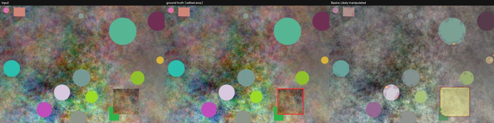

<div align="center">

# Basira · بصيرة

**Explainable forensics for edited and AI-generated images, audio and video.**
It shows *where* a file was changed and *why* it thinks so — and says so plainly when it cannot tell.

[العربية](README.ar.md) · [How each detector works](docs/METHODS.md) · [Benchmarks](#measured-results) · [Publishing checklist](docs/PUBLISHING.md)

</div>



```console
$ basira scan splice_2.jpg
splice_2.jpg  [image]
  Likely manipulated
  manipulation  ████████████████░░░░  80.0%
  AI generation ░░░░░░░░░░░░░░░░░░░░   0.0%
  provenance    ░░░░░░░░░░░░░░░░░░░░   0.0%
  · [JPEG double-quantisation map] The image was JPEG-compressed at least twice (8 DCT
    frequencies show double-quantisation periodicity), and a compact region (3.5% of blocks)
    does NOT share that history — consistent with content pasted in before the last save.
  report: splice_2.jpg.basira.html
```

(The image above and this output come from `python examples/make_demo.py`, which generates
forgeries with known ground truth.)

## What it is

One Python package, three engines, one report format:

| Engine | Finds | Localises |
|---|---|---|
| **Image** | splicing, copy-move cloning, smooth in-painting (generative fill), generator metadata, C2PA / IPTC AI labels, stale EXIF thumbnails, generator upsampling fingerprints in lossless files | pixel heat-map + boxes |
| **Audio** | cuts (mains-hum phase jumps), inserted segments (room-noise and bandwidth changes), inserted digital silence, hard-cut clicks, TTS-like band-limiting and unnaturally clean pauses, generator tags | time ranges |
| **Video** | removed frames, replayed footage, frozen frames, foreign footage cut in, a previous encoding's GOP, edit lists, generator tags; plus the full audio engine on the sound track | time ranges |

Design choices that differ from most detectors:

- **Evidence, not a magic number.** Every detector is a documented signal-processing method that outputs its raw statistic, its threshold, a plain-language sentence and a map or time range. Nothing is a black box.
- **Calibrated to stay quiet.** A detector's score is 0.5 exactly at its decision threshold, and thresholds are set from measured clean-file distributions. Quiet detectors add nothing to the verdict, and weak hints of different kinds never add up to one. The price is recall: it misses more than it catches.
- **It never says "authentic".** The best possible result is *"No significant traces found"*, because re-compression, resizing and careful editing erase traces.
- **No model downloads, no network, no GPU.** `pip install` and run. Files never leave your machine; decoders are restricted to local files and playlist / reference formats are refused.

## Install

```bash
pip install git+https://github.com/OWNER/basira.git
```

Python 3.9+. Dependencies: NumPy, SciPy, Pillow, OpenCV (headless), soundfile, imageio-ffmpeg (bundles an FFmpeg binary, so nothing else needs installing).

## Use

```bash
basira scan photo.jpg                  # terminal summary + photo.jpg.basira.html
basira scan clip.mp4 voice.wav --report-dir reports/
basira scan upload.png --json --no-html        # machine-readable
basira scan evidence/*.jpg --fail-on 2         # exit status 2 if anything is "Suspicious" or worse
basira serve                                   # local drag-and-drop UI on 127.0.0.1
```

```python
import basira

r = basira.analyze("photo.jpg")
r.verdict            # "Likely manipulated"
r.scores             # {"manipulation": 0.80, "ai_generation": 0.0, "provenance": 0.0, "overall": 0.80}
r.fused_heatmap      # HxW float32 localisation map (images, video key frames)
r.fused_segments     # suspicious time ranges (audio, video)
for e in r.evidences:
    print(e.detector, e.score, e.confidence, e.summary, e.details)
```

The HTML report is a single self-contained file: verdict, the localisation map over the image with an opacity slider, every detector's visual, raw measurements, and a timeline for audio/video.

## Measured results

Every number here is produced by a script in this repository, so you can re-run it.
Nothing below is cherry-picked: the first run on public data was bad, and the fixes it
forced are listed under it.

### Public datasets

`benchmarks/public_datasets.py`, default thresholds, "flagged" = verdict "Suspicious" or worse.

| Dataset | Originals flagged | Forgeries flagged | Pixel F1 when flagged | ROC-AUC |
|---|---|---|---|---|
| **Columbia Uncompressed Splicing** (183 camera originals, 180 splices, TIFF) | **0 / 183** | 54 / 180 (30%) | 0.73 | 0.69 |
| **CoMoFoD small** (200 originals, 200 copy-move forgeries, PNG) | **12 / 200** | 108 / 200 (54%) | 0.78 | 0.76 |

CoMoFoD after JPEG re-compression of the whole image (the dataset's own `JC` variants):

| | Q90 | Q80 | Q70 | Q60 | Q50 | Q40 | Q30 | Q20 |
|---|---|---|---|---|---|---|---|---|
| Forged flagged (of 200) | 90 | 65 | 59 | 50 | 42 | 34 | 26 | 13 |
| Originals flagged (of 200) | 12 | 9 | 6 | 4 | 8 | 7 | 0 | 0 |

How to read this:

- **False alarms are rare; misses are common.** That is the intended trade-off for a tool whose output may be used against someone, but it means a clean result proves little.
- **Columbia** images are uncompressed, so the JPEG-history detector cannot apply. What fires is the colour-filter-array test, which only sees splices whose two sources had opposite Bayer phase — about half of them by construction.
- **CoMoFoD**: all 12 flagged originals come from two scenes that contain identical *printed* objects (three identical beer coasters; bound journal volumes with the same label). Mass-printed copies share their fine detail just as a digital clone does, and these low-noise images give the detector nothing else to go on. This is a real limitation, not a labelling quirk. In the other direction, clones that were rotated or rescaled are often rejected, because resampling destroys the fine detail the detector insists on.
- **The first run on these datasets was worse**: 23 of 183 Columbia originals were flagged, and at JPEG quality 90 more than half of the CoMoFoD originals were. Fixing that meant rebuilding the copy-move verification, replacing the CFA test, cutting the noise detector in half and adding a comb-purity check to the JPEG detector (see [docs/METHODS.md](docs/METHODS.md)).
- **Caveat:** several thresholds were then tuned on these same two datasets, so the false-alarm figures above are in-sample and somewhat optimistic. Run it on data it has never seen (`benchmarks/evaluate_folder.py`) before trusting it.

### Real content with forgeries made by this project

`benchmarks/real_content.py` cuts real photographs and real video frames into 1024×768 photos, simulates a camera save, and builds forgeries with ground truth. Run on 34 textured crops from two photographs and one 4K video (not bundled: point the script at your own folder):

| Family | Flagged | Edit correctly located |
|---|---|---|
| Clean, one save | **0 / 34** | – |
| Clean, saved twice | **0 / 34** | – |
| Splice from another photo | 24 / 34 | 24 / 34 |
| Copy-move | 29 / 34 | 29 / 34 |
| Object removal (OpenCV in-painting) | 13 / 34 | 13 / 34 |

After the forgery is post-processed the way platforms do it:

| Flagged after… | re-save Q85 | re-save Q70 | re-save Q50 | downscale 75% | downscale 50% |
|---|---|---|---|---|---|
| Clean (false positives) | 0 / 34 | 0 / 34 | 0 / 34 | 0 / 34 | 0 / 34 |
| Splice | 11 / 34 | 0 / 34 | 0 / 34 | 2 / 34 | 0 / 34 |
| Copy-move | 28 / 34 | 23 / 34 | 15 / 34 | 24 / 34 | 21 / 34 |
| Object removal | 6 / 34 | 0 / 34 | 0 / 34 | 0 / 34 | 0 / 34 |

**Compression-history traces (splice, in-painting) are gone after one more lossy save.** Only geometric evidence (copy-move) survives. Crops without texture (blank sky, fog) are excluded: an edit there leaves nothing to measure.

### Synthetic, with a simulated camera

`benchmarks/synthetic_images.py` (Bayer sampling, sensor noise, demosaicing, JPEG), 16 images per family: clean 0 / 32 flagged; splice 16 / 16; copy-move 13 / 16; JPEG cut-out pasted off-grid 16 / 16; smooth in-painting 6 / 16.

### Audio

`benchmarks/synthetic_audio.py`, 10 recordings of 30 s (speech-like signal, room noise, weak mains hum), edits at random positions; located = flagged with a segment within 0.5 s of the true edit:

| Family | Result |
|---|---|
| Clean recording flagged | **0 / 10** |
| 0.4–1.2 s removed (mains-hum phase jump) | 8 / 10 |
| 3 s inserted from another room | 10 / 10 |
| 0.3 s of digital silence inserted | 10 / 10 |

A 10-minute 48 kHz file analyses in about 5 s. **Audio has only been measured on synthetic recordings.** Given what public data did to the image numbers, expect real recordings to be harder.

### Video

`tests/test_video.py`: clean clips 0 flagged; removed frames, replayed footage, frozen frames and inserted foreign footage each located to within 0.25 s; a previous encoding's GOP length recovered exactly for streams without B-frames. **Video has only been measured on synthetic clips**, plus false-positive checks on two real 4K videos.

## Limitations (read this)

- **"Is this AI-generated?" is the weakest question here.** Without a trained model, Basira answers it reliably only through provenance: generator metadata, C2PA Content Credentials and IPTC `trainedAlgorithmicMedia` labels (decisive when present — and trivially stripped). The pixel-level generator fingerprint works on lossless files that were not resized; it is blind on JPEGs, because JPEG's 8×8 blocking occupies the same frequencies. The audio "TTS-like" cues also fire on noise-gated and phone audio and are weighted low on purpose. A modern diffusion image re-saved by a social network will usually come back as *"No significant traces found"*.
- **Localising edits is the stronger part, and it is still modest.** On public data Basira flags about half of copy-move forgeries and under a third of uncompressed splices (tables above). Each method has a precondition: the double-quantisation map needs a JPEG saved at least twice, directly, with the grid intact; the colour-filter test needs a near-lossless camera image; copy-move needs texture, rejects most rotated or rescaled clones, and cannot tell a digital clone from identical printed objects.
- **Resizing, screenshots and platform re-compression destroy most traces** — see the robustness table above. An image that went through WhatsApp, X or Instagram has usually lost the splice and in-painting evidence. That is physics, not a bug.
- **Video**: the double-compression test is unreliable when the stream uses B-frames (stated in its output); a deliberate jump cut looks the same as removed frames; codecs flatten the noise differences between sources.
- **Two public image datasets, none for audio or video.** CASIA, IMD2020, NIST16, ASVspoof and FakeAVCeleb have not been run, and the thresholds were tuned on the two datasets that were. Use `benchmarks/evaluate_folder.py`; contributions with reproducible numbers are very welcome.
- A forensic tool gives leads for a human examiner. Do not use its output as the sole basis for an accusation.

## How it decides

Each detector returns `score` (0.5 = its threshold) and `confidence` (how applicable it is to *this* file — e.g. ELA on a PNG gets almost none). Only the part of a score above 0.5 counts, scaled by confidence, and detectors combine with a noisy-OR. So one strong trusted detector is enough, several moderate independent ones reinforce each other, and quiet ones contribute nothing. Generator metadata is "decisive" and short-circuits the verdict. Details: [docs/METHODS.md](docs/METHODS.md).

## Develop

```bash
git clone https://github.com/OWNER/basira.git && cd basira
python -m venv .venv && .venv/bin/pip install -e ".[dev]"
.venv/bin/python -m pytest                      # 81 tests, ~2 min
.venv/bin/python benchmarks/synthetic_images.py # synthetic image numbers
.venv/bin/python benchmarks/real_content.py --sources ~/Pictures/some_folder --robust
.venv/bin/python examples/make_demo.py          # demo forgeries, figures and HTML reports
```

Adding a detector: write a function that returns a `basira.core.Evidence`, register it in the engine's `__init__.py`, add a synthetic forgery with ground truth and a clean-file test. A detector that cannot stay quiet on clean files does not get merged — one was removed during development for exactly that reason.

## License

MIT. See [LICENSE](LICENSE).
